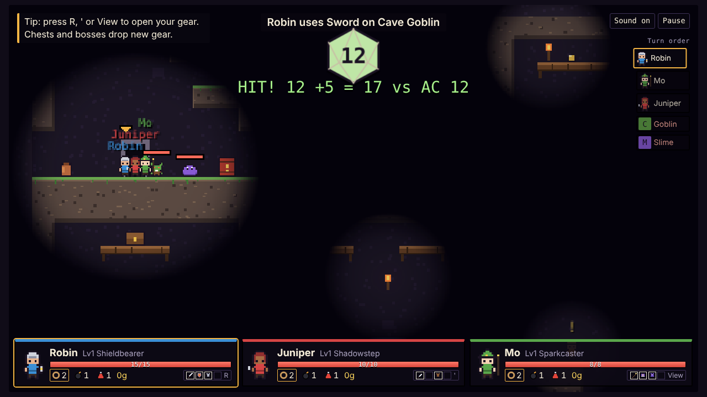
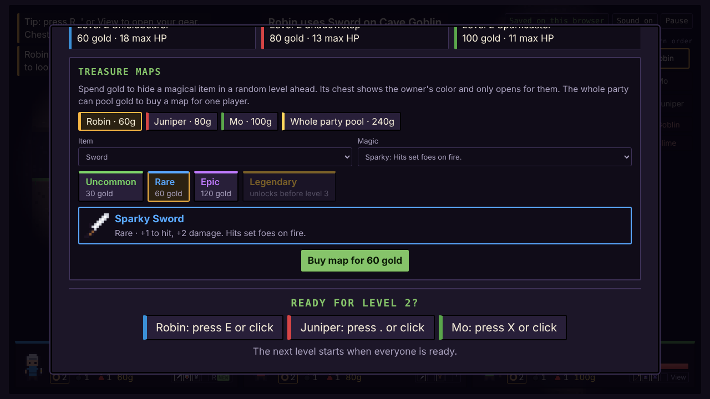

# Pixel Party Dungeon

A couch co-op dungeon crawler for 1–4 players, made for 10-year-olds to play
and to watch. It mixes **Spelunky** (real-time platforming through randomly
generated caves, where fire, explosions and shoves cause chaos) with
**Baldur's Gate 3** (turn-based fights decided by big, visible d20 rolls, and
conversations with skill checks). Each adventure has a new villain written by
Claude.

It's a single, dependency-free HTML file: a hand-written platformer and
lighting engine on Canvas, pixel sprites drawn from code, and synthesized
sound. This is the playable prototype of spec phases 1–4 (3 levels); the full
design is a 10-level campaign.



## Where it runs

- **As a Claude artifact** (the main way to play). There, Claude writes each
  adventure's villain, quest and NPC conversation, and saves go to the host's
  private Claude storage so they follow them to any device.
- **As a plain web page** (`index.html` opened in a browser or hosted
  anywhere). Without Claude it uses a built-in library of ready-made stories,
  and saves stay in that browser.

## How to play

1. On the party screen, add 1–4 players. Each picks a name, class, look and
   stats, and their controls. Two players can share one keyboard; 3–4 players
   need controllers.
2. Explore in real time: run, jump, climb ladders and ropes, pick up and throw
   pots and barrels, and open chests.
3. When an enemy spots you, everyone freezes into a turn-based fight right
   where they stand. On your turn, move up to 6 tiles and take one action:
   Attack, your class Ability, Shove, Help up a downed friend, drink a Potion
   or Run away. Press Act to roll the big d20 yourself.
4. Get everyone to the exit door. Between levels, the camp screen levels the
   party up and sells treasure maps. The next level starts when everyone
   presses Ready.

| Action | Keyboard 1 | Keyboard 2 | Controller |
| --- | --- | --- | --- |
| Move / climb | A D / W S | Arrow keys | Stick or D-pad |
| Jump (down + jump drops through) | Space | Right Shift or / | A |
| Act: talk, open, pick up, class trick, roll, confirm | E | . or Enter | X |
| Use item (down + item switches) / next battle action | Q | , | Y |
| Throw what you carry / end battle turn | F | ; | B |
| Open your gear | R | ' | View / Back |
| Pause | Esc | Esc | Start |

## Highlights

- **Spelunky-style levels.** Each level is a 4×4 grid of hand-drawn room
  templates, randomly picked and mirrored, with a guaranteed path from the
  entrance at the top to the exit at the bottom.
- **Chaos.** Fire spreads across wooden platforms and ladders and burns
  them away. Bombs and barrels blow holes in the rock and chain-react. Shoves
  and bouncy weapons send enemies into spikes or off ledges, where they take
  fall damage.
- **Kid-friendly rules.** Hazards and falls can't knock anyone out (they stop
  at 1 HP); only fights can. Downed players roll death saves, friends can help
  them up, and a party wipe sends everyone back to the level start with any
  gear they found waiting in chests of their color.
- **Dice you can watch.** Every roll, including enemy rolls and death saves,
  appears big at the top of the screen with its bonus, total and target, built
  for an audience on the couch or a stream.
- **Four classes.** Shieldbearer, Shadowstep, Sparkcaster and Lanternkeeper,
  each with an exploration trick, an attack and an ability.
- **Gear with magic.** Weapon, off-hand, armor and trinket slots; 12 item
  types; five rarities; 15 magic effects (Sparky, Frosty, Feather-light,
  Springy and more) that hook into combat, movement and healing.
- **Treasure maps.** Spend gold at camp to plant a chosen magical item in a
  random later level, alone or by pooling gold with the party. Only its owner
  can open the chest. Gear and gold can't be traded.
- **Saves.** Auto-saves at every level start, at camp and after buying a map,
  with a list of saved adventures to continue or delete.
- **Kid-safe story writing.** Claude's story is checked against a schema,
  length limits and a whole-word blocklist; anything that fails falls back to
  a ready-made story.



## Design spec and notes

[Design notes](../../docs/pixel-party-dungeon/README.md) explain the why behind
every decision, and a [case study](../../docs/pixel-party-dungeon/case-study.md)
covers how the project was run and coached.

The full game design (10-level campaign, online play, AI Studio build target,
build phases and open risks) lives in the Claude doc
**Game Design Spec: Pixel Party Dungeon**. This prototype tracks it; where they
differ, the spec describes the target and this README describes what's built.

Not in the prototype yet: online multiplayer, NPC companions, grappling hooks,
emotes, levels 4–10 and their biomes, and controller support on the camp
screen.

## Tests

`tests/smoke.py` drives the game headlessly in Chrome with Playwright. It
checks level generation (300 levels), a full battle, the gear screen, treasure
maps and the ready check, wipe chests, fall damage, Run away, and saving and
loading.

```bash
pip install playwright
python3 apps/pixel-party-dungeon/tests/smoke.py            # uses Playwright's Chromium
CHROME=/usr/bin/google-chrome python3 apps/pixel-party-dungeon/tests/smoke.py
```

The game exposes its state as `window.__PPD` for tests.
